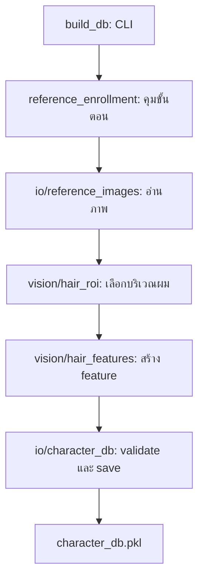
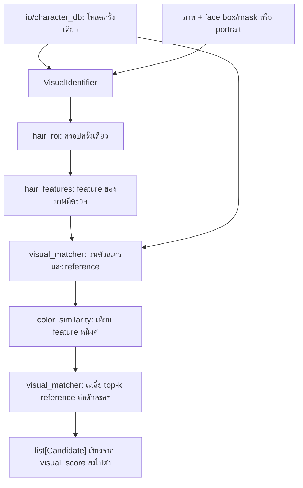

# โครงสร้างและแผนภาพพื้นฐาน — อัปเดต 14 ตุลาคม 2026

เพิ่มเติม 15 ตุลาคม: [Project Workspace](WORKSPACE_GUIDE_TH.md) เป็นอีก workflow ที่สแกนทั้งเรื่องด้วย embeddings ภาพ/เสียง และ SQLite
เนื้อหาด้านล่างอธิบาย baseline reference เดิม ซึ่งยังใช้งานได้ ไม่ใช่โครงสร้างทั้งหมดของ Workspace ใหม่

ระบบรุ่นแรกเชื่อมครบแล้ว ดู [แผนที่ไฟล์ล่าสุด](FILE_MAP.md), [คู่มือใช้งาน](USER_GUIDE_TH.md)
และ [ทางเดินข้อมูลปัจจุบัน](CODE_WALKTHROUGH_TH.md) สำหรับ worker/GUI/CLI ที่เพิ่มใหม่
แผนภาพด้านล่างยังใช้อธิบาย enrollment และภาพนิ่งได้

ไฟล์นี้อธิบายภาพรวม; หากกลับมาเขียนต่อให้เริ่ม [Path Guide บท 0–4](BUILD_PATH_COURSE_TH.md)
และเปิด [Function Flow](FUNCTION_FLOW_TH.md) สำหรับชื่อฟังก์ชัน ผู้เรียก input/return และข้อผิดพลาด
ระบบสร้าง reference, วิเคราะห์ช่วงวิดีโอ และช่วยตรวจแก้/ส่งออกผลได้; ความแม่นยำอัตโนมัติยังต้องวัดจาก ground truth

## จุดเริ่มต้น 3 จุด

| ต้องการทำอะไร | เริ่มอ่านที่ไหน |
|---|---|
| สร้างหรือเพิ่ม reference | `src/build_db.py` → `src/pipeline/reference_enrollment.py` |
| นำภาพมาเทียบฐาน reference | `src/pipeline/visual_identification.py` → คลาส `VisualIdentifier` |
| พัฒนาระบบระบุผู้พูดเต็มรูปแบบ | `src/pipeline/speaker_attribution.py` + `video_analysis.py` |

`vision` เป็นกลุ่มฟังก์ชันประมวลผลภาพ ไม่ใช่คลาสพ่อที่ทุกไฟล์ต้องสืบทอด
`VisualIdentifier` เป็นตัวประสานงานแบบ composition: เก็บฐานข้อมูลหนึ่งชุด แล้วเรียกฟังก์ชันย่อยตามลำดับ
ฟังก์ชันคำนวณ histogram ไม่จำเป็นต้องเป็นคลาส เพราะไม่ได้มีสถานะที่ต้องเก็บระหว่างการเรียก

## Structure

```text
src/
  __init__.py                 โหลด config ก่อน native libraries
  build_db.py                 CLI เท่านั้น: อ่าน argument และรายงานผล
  main.py                     PyQt UI: player, table, waveform, seek
  core/
    models.py                 รูปแบบข้อมูลที่ทุกส่วนใช้ร่วมกัน
    config.py                 path และค่าควบคุม พร้อมระบุค่าที่รอใช้ในอนาคต
  io/
    reference_images.py       อ่านรูป local / URL / AniList; ไม่บันทึก database
    character_db.py           validate / load / save PKL; ไม่ประมวลผลรูป
    subtitle_io.py            อ่าน SRT → list[SubtitleSegment]
    result_export.py          JSON/SRT + เปิด session กลับมา
  vision/
    hair_roi.py               ภาพ + face box/mask → บริเวณผม
    hair_features.py          hair ROI → สีเด่น + histogram; ไม่ครอปซ้ำ
    color_similarity.py       feature สองชุด → คะแนนความคล้ายหนึ่งคู่
    visual_matcher.py         query + database → Candidate เรียงตาม visual_score
    face_detect.py            anime-face YOLO detector
    character_tracking.py     IoU + scene/gap resets
    active_speaker.py         mouth motion ในช่วงพลังงานเสียง
  audio/
    audio_extract.py          FFmpeg → mono WAV (ย้ายจาก UI)
    vad.py                    RMS energy + waveform (ไม่ใช่ speech-specific)
    speaker_features.py       TODO ต่อท้าย: voice embedding/diarization
  pipeline/
    reference_enrollment.py   ประสานงานสร้าง/เพิ่ม reference
    visual_identification.py  ประสานงานจับคู่ภาพนิ่ง โหลดฐานข้อมูลครั้งเดียว
    speaker_attribution.py    ประสานวิดีโอ เสียง สคริปต์ + evidence
    confidence_scoring.py     threshold/coverage/margin + preserve script
```

ไม่มี `src/extractor.py` หรือ `src/matcher.py` อีกแล้ว: ย้าย implementation ไปที่ vision โดยไม่เหลือสำเนาสองชุด

## เส้นทางสร้างฐานข้อมูล



เส้นด้านบนแสดงลำดับข้อมูลที่ workflow ควบคุม ไม่ใช่ว่าแต่ละไฟล์ import ไฟล์ถัดไปเองทั้งหมด
ภาพ reference ต้องเป็น portrait ตัวละครเดียว หากไม่ส่ง face box/mask ตัวครอปจะใช้ส่วนบน 45% เหมือน baseline เดิม
อย่านำเฟรมที่มีหลายคนมาใช้ fallback นี้

## เส้นทางจับคู่ภาพ



- `identify_portrait(image, bbox=None, hair_mask=None)` ใช้เมื่อยังต้องเลือกบริเวณผม
- `identify_hair_roi(hair_roi)` ใช้เมื่อครอปผมมาแล้ว จะไม่ตัดส่วนบนของ ROI ซ้ำ
- `top_k=3` เลือก reference ที่ดีที่สุดไม่เกิน 3 รูปต่อคนมาเฉลี่ย ไม่ได้จำกัดจำนวนตัวละครที่คืน
- สีเด่นและ histogram ถูกสร้างใน hair_features; color_similarity แค่เปรียบเทียบตัวเลขที่สร้างแล้ว
- คะแนนภาพใช้ `0.70 * histogram + 0.30 * dominant_color` จาก config; ยังไม่มีคะแนนทรงผม
- `Candidate.final_score`, `active_speaker_score`, `script_score` เป็น `None` จนกว่าจะประเมินจริง
- visual_score เป็นคะแนนความคล้าย ไม่ใช่ความน่าจะเป็นหรือข้อยืนยันว่ากำลังพูด

## สัญญาข้อมูลที่ใช้จริง

`VisualFeatures` และ `ReferenceImage` เป็น TypedDict: ช่วยระบุชนิดข้อมูล แต่ค่าตอนรันยังเป็น dictionary
จึงใช้ `.pkl` เดิมได้โดยไม่เปลี่ยน key และไม่ต้อง rebuild เพราะการย้ายโค้ดครั้งนี้

```python
database = {
    "Hoshino Aqua": [
        {
            "filename": "Hoshino Aqua/001.jpg",
            "features": {
                "dominant_hsv": [17.0, 220.0, 220.0],
                "histogram": ...,  # numpy float32 array, baseline ขนาด (30, 32)
            },
        },
    ],
}
```

ไม่มี CharacterProfile อีกแบบมาทับ schema นี้ และไม่ใช้ key `color_histogram`
loader ตรวจรูปแบบก่อนส่งให้ผู้เรียก ส่วน writer เขียนไฟล์ชั่วคราวก่อนแทนที่ไฟล์เดิมเมื่อเขียนสำเร็จ
หากเพิ่ม reference แล้วพบฐานเดิมเสีย จะรายงาน error ไม่เปลี่ยนเป็นฐานว่างแล้วทับของเดิม

## คำสั่งใช้งาน

รันจาก root ของโปรเจกต์ใน environment ที่ติดตั้ง dependencies แล้ว:

```bash
venv/bin/python -m src.build_db
venv/bin/python -m src.build_db --name "Hoshino Aqua" --file "/absolute/path/portrait.png"
venv/bin/python -m src.build_db --help
venv/bin/python -m src.main
venv/bin/python -m unittest discover -s tests -v
```

`--url` และ `--fetch-api` ยังมีอยู่ แต่ไม่มี preview/selection UI และ `--series` ยังเป็นเพียงข้อความเพิ่มในคำค้น ไม่ใช่ตัวกรองชื่อเรื่องแบบตรงตัว
ใช้ `--reference-dir` กับ `--database` เมื่อทดสอบโดยไม่ต้องแตะข้อมูลจริง
คำสั่ง build แบบไม่ระบุแหล่งภาพจะ rebuild และแทนที่ PKL ด้วย reference ที่ใช้ได้ ต้องอ่าน warning หากบางภาพถูกข้าม
PKL ควรมาจากแหล่งที่เชื่อถือได้เท่านั้น; schema validation ไม่ทำให้ pickle จากภายนอกปลอดภัย

ตัวอย่างการเรียกจาก Python:

```python
from src.pipeline.visual_identification import VisualIdentifier
from src.io.reference_images import read_reference_image
from src.core.config import REFERENCES_DIR

identifier = VisualIdentifier.from_database()  # โหลดครั้งเดียว ใช้ซ้ำหลายภาพ
portrait = read_reference_image(REFERENCES_DIR / "Hoshino Aqua" / "001.jpg")
candidates = identifier.identify_portrait(portrait)
for candidate in candidates:
    print(candidate.character_name, f"{candidate.visual_score:.1%}")
```

ตัวอย่างนี้ใช้ภาพที่อยู่ในฐานเพื่อเช็คการต่อสายเท่านั้น การวัดความแม่นยำต้องใช้ภาพใหม่ที่ไม่ได้เป็น reference

## สิ่งที่ยังไม่ทำและลำดับถัดไป

1. ตรวจผลกับภาพใหม่/ROI จาก Test_1 แล้วปรับคุณภาพ reference ก่อน
2. เขียน video sampler ให้มีขอบเขตจำนวนเฟรม และ detector/manual box กับ tracking
3. เขียน VAD/การขยับปาก แล้วเก็บหลักฐานต่อ track ในช่วงเวลาของ subtitle
4. เขียน confidence_scoring และ speaker_attribution เพื่อตัดสิน CHARACTER/DEFAULT/UNKNOWN
5. เขียนและทดสอบ export ก่อน แล้วเชื่อม SRT parser/pipeline/export เข้าหน้าจอผ่าน worker ที่ยกเลิกงานได้

UI นำเข้า SRT/session JSON, preview, วิเคราะห์ผ่าน QThread, แก้ชื่อและ export ได้แล้ว
VAD ที่มีเป็น RMS energy ซึ่งยังแยกเพลง/เสียงรบกวนจาก speech ไม่ได้
config มี MAX_* สำหรับงานต่อยอด แต่ baseline KMeans ยังใช้พิกเซลที่ผ่าน mask ทั้งหมด ไม่ควรเข้าใจว่ามีเพดาน CPU/RAM แล้ว

## เปลี่ยนพฤติกรรมตรงไหนบ้าง

- สูตรสีและ histogram bins คงเดิม; น้ำหนัก config ถูกเชื่อมเข้าตัวเปรียบเทียบจริง
- crop และ extract แยกชัดเจน ป้องกันการครอป ROI ซ้ำ
- hair mask ตัดพิกเซลนอก mask ออกจริง แก้ของเดิมที่ใช้เพียงกรอบสี่เหลี่ยมของ mask
- ค่า evidence ที่ยังไม่ประเมินใช้ None; อย่า format final_score เป็นเปอร์เซ็นต์ก่อนตรวจว่ามีค่า
- คำสั่ง CLI ล้มเหลวคืน exit code ที่ไม่ใช่ศูนย์; ฐานว่าง/เสียไม่ถูกเขียนทับเงียบ ๆ
- API ฟังก์ชันใหม่ดูจากโมดูลในแผนผัง; ไม่เหลือ import จาก src.extractor/src.matcher
- add_character_reference อยู่ใน pipeline/reference_enrollment และคืน Path หรือ raise แทน boolean เดิม
- ถ้าเคยเรียกสคริปต์ด้วย python src/build_db.py ให้เปลี่ยนเป็น python -m src.build_db

รายละเอียดการย้ายของเดิมอยู่ใน [LEGACY_CODE_STATUS_TH.md](LEGACY_CODE_STATUS_TH.md)
